<!-- Generated by scripts/build.mjs from catalog.yaml and data/repos.json. Edit those, not this file. -->

<a href="https://doc.tbusos.com/sketchbook/"><picture><source media="(prefers-color-scheme: dark)" srcset="art/banner-en-dark.svg"></picture></a>

<b>33 open-source projects</b> by <a href="https://github.com/TbusOS">TbusOS</a> · 1,532 commits · 6 languages AI agent tooling · Linux kernel &amp; embedded · learning and running LLMs

<a href="https://doc.tbusos.com/sketchbook/"><b>Open the sketchbook →</b></a> · <a href="README_zh.md">中文</a>

## Featured

<a href="https://github.com/TbusOS/sky-skills"><picture><source media="(prefers-color-scheme: dark)" srcset="art/card-sky-skills-en-dark.svg"></picture></a>
<a href="https://github.com/TbusOS/android-llm-bridge"><picture><source media="(prefers-color-scheme: dark)" srcset="art/card-android-llm-bridge-en-dark.svg"></picture></a> 
<a href="https://github.com/TbusOS/ai-doc"><picture><source media="(prefers-color-scheme: dark)" srcset="art/card-ai-doc-en-dark.svg"></picture></a>
<a href="https://github.com/TbusOS/whetstone"><picture><source media="(prefers-color-scheme: dark)" srcset="art/card-whetstone-en-dark.svg"></picture></a> 
<a href="https://github.com/TbusOS/engram"><picture><source media="(prefers-color-scheme: dark)" srcset="art/card-engram-en-dark.svg"></picture></a>
<a href="https://github.com/TbusOS/flowsight"><picture><source media="(prefers-color-scheme: dark)" srcset="art/card-flowsight-en-dark.svg"></picture></a> 

If one of these saves you time, a ★ on its repository helps other people find it.

## The shelf

<a href="https://doc.tbusos.com/sketchbook/#shelf"><picture><source media="(prefers-color-scheme: dark)" srcset="art/shelf-en-dark.svg"></picture></a>

One book per project: thicker means more commits, colour is the group, ★ marks the featured six. Click to open the interactive version.

## All projects

### Skills & memory for AI agents

Teach a coding agent once and keep what it learned — as skills it can load, or as plain-markdown memory you own.

| Project | What it does | Activity | Demo |
|---|---|---|---|
| **[sky-skills](https://github.com/TbusOS/sky-skills)** HTML · stable | Claude Code skills for design, kernel work, workflows and review — eleven page styles, each with a live demo. | 420 commits 2026-10 | [live ↗](https://doc.tbusos.com/sky-skills/) |
| **[whetstone](https://github.com/TbusOS/whetstone)** Shell · stable | Distill a dev session into a portable Agent Skill, then check it against evidence rules you can run. | 55 commits 2026-10 | [live ↗](https://doc.tbusos.com/whetstone/) |
| **[whetstone-curator](https://github.com/TbusOS/whetstone-curator)** in progress | The team side of whetstone — pick the right lessons from teammates' libraries, or gather everyone's into one. | 2 commits 2026-08 |  |
| **[engram](https://github.com/TbusOS/engram)** Python · in progress | Local, model-agnostic memory kept as plain markdown on your disk — any LLM can read it, and it keeps its own quality up. | 97 commits 2026-08 | [live ↗](https://doc.tbusos.com/engram/) |
| **[proofmark](https://github.com/TbusOS/proofmark)** HTML · stable | Nine design languages a coding agent can write in, plus a check that fails any page that doesn't match. | 10 commits 2026-09 | [live ↗](https://doc.tbusos.com/proofmark/) |
| **[cursor-memory-server](https://github.com/TbusOS/cursor-memory-server)** TypeScript · stable | Persistent memory for Cursor — hooks plus MCP, recalled at the start of each session, global and per project. | 11 commits 2026-03 |  |
| **[llm-wiki](https://github.com/TbusOS/llm-wiki)** Python · in progress | Let an LLM compile your sources into a cross-linked markdown wiki and keep it up to date, Karpathy-style. | 1 commit 2026-04 |  |
| **[astock-lab](https://github.com/TbusOS/astock-lab)** Python · stable | An A-share stock research bench — 13 free tools and 3 Agent Skills that teach the AI how to reason, not just fetch data. | 40 commits 2026-09 |  |

### Agents on real machines

Let an LLM agent drive an Android phone, a Windows host or a desktop app, and get structured results back.

| Project | What it does | Activity | Demo |
|---|---|---|---|
| **[android-llm-bridge](https://github.com/TbusOS/android-llm-bridge)** Python · stable | Let an LLM agent debug a real Android device over adb, ssh or UART — through MCP, a CLI or a web API. | 379 commits 2026-10 | [live ↗](https://doc.tbusos.com/android-llm-bridge/) |
| **[windows-llm-bridge](https://github.com/TbusOS/windows-llm-bridge)** Python · in progress | Drive a Windows host like a function call — cmd, PowerShell, file transfer and vendor tools, with structured results. | 19 commits 2026-05 |  |
| **[DeskPilot](https://github.com/TbusOS/DeskPilot)** TypeScript · stable | Test automation for Tauri and Electron apps — DOM tests first, a vision model only when a selector breaks. | 14 commits 2026-03 |  |

### Claude Code companions

A statusline, crash protection, a network monitor, and one-page views of your repos and sessions.

| Project | What it does | Activity | Demo |
|---|---|---|---|
| **[repo-atlas](https://github.com/TbusOS/repo-atlas)** Python · stable | Catalog every repo in your workspace — one HTML page for people, one compact index for AI agents. | 30 commits 2026-07 | [live ↗](https://doc.tbusos.com/repo-atlas/) |
| **[work-atlas](https://github.com/TbusOS/work-atlas)** Python · stable | Rebuild what you actually worked on from your Claude Code sessions, and compare it with what you planned. | 16 commits 2026-07 | [live ↗](https://doc.tbusos.com/work-atlas/) |
| **[claude-egress-monitor](https://github.com/TbusOS/claude-egress-monitor)** Python · stable | See where Claude Code, the desktop app and the browser really leave your machine — exit IP, region, telemetry, latency. | 12 commits 2026-08 | [live ↗](https://doc.tbusos.com/claude-egress-monitor/) |
| **[claude-code-memory-checkpoint](https://github.com/TbusOS/claude-code-memory-checkpoint)** Shell · stable | Three hooks that keep long Claude Code sessions safe from crashes, auto-compact and /clear. | 5 commits 2026-05 | [live ↗](https://doc.tbusos.com/claude-code-memory-checkpoint/) |
| **[sky-claude-hud](https://github.com/TbusOS/sky-claude-hud)** Python · stable | A two-line Claude Code statusline that works over SSH and in Xshell — pure Python, no GUI. | 8 commits 2026-10 |  |
| **[memcode](https://github.com/TbusOS/memcode)** C · stable | An MCP server that keeps a codebase in memory so Claude Code reads it faster, with live reload. | 6 commits 2026-03 |  |

### Learning & running LLMs

Papers explained, a build-it-yourself course, and tools for running and training models on your own machine.

| Project | What it does | Activity | Demo |
|---|---|---|---|
| **[ai-doc](https://github.com/TbusOS/ai-doc)** Python · stable | AI papers and articles worth reading, with Chinese translations and animated explainers you can step through. | 87 commits 2026-10 | [live ↗](https://doc.tbusos.com/ai-doc/) |
| **[my-chat](https://github.com/TbusOS/my-chat)** HTML · stable | Learn LLMs by building them — from running Ollama to training nanoGPT and writing your own tokenizer. | 37 commits 2026-10 | [live ↗](https://doc.tbusos.com/my-chat/) |
| **[Helix](https://github.com/TbusOS/Helix)** HTML · in progress | Local multi-model chat — Ollama, LM Studio and llama.cpp behind one adapter, with group-chat modes and KV-cache monitoring. | 7 commits 2026-04 | [live ↗](https://doc.tbusos.com/Helix/) |
| **[mlx-pager](https://github.com/TbusOS/mlx-pager)** Python · in progress | OS-style memory paging for MLX on Apple Silicon — train a 27B model on a 24 GB Mac by paging to the SSD. | 3 commits 2026-04 |  |

### Linux kernel, drivers & embedded

Call-flow tracing, Kconfig checks, CVE patching and study material for people who work below userspace.

| Project | What it does | Activity | Demo |
|---|---|---|---|
| **[flowsight](https://github.com/TbusOS/flowsight)** Rust · in progress | A cross-platform IDE that draws the call flow of your code as it actually runs. Written in Rust. | 134 commits 2026-01 |  |
| **[openwrt-tools](https://github.com/TbusOS/openwrt-tools)** C · stable | A toolchain for making OpenWrt kernel CVE patches — detect, adapt and merge patches, with help in English and Chinese. | 58 commits 2025-10 |  |
| **[kconform](https://github.com/TbusOS/kconform)** Shell · stable | Lint, verify, minimize and diff defconfigs across Kconfig projects — U-Boot, Linux, Buildroot and OpenWrt. | 15 commits 2026-04 |  |
| **[fptrace](https://github.com/TbusOS/fptrace)** C · stable | Find out at run time which function a function pointer really points to, and print the call stack. | 10 commits 2026-02 |  |
| **[Linux-driver-analyzer](https://github.com/TbusOS/Linux-driver-analyzer)** Python · in progress | Static analysis that untangles the call flow of a large Linux driver and draws it for you. | 9 commits 2026-01 |  |
| **[SkymOS](https://github.com/TbusOS/SkymOS)** C · in progress | A teaching OS for ARM32, built stage by stage — from booting and printing over UART up to a small kernel. | 8 commits 2025-08 |  |
| **[usb-learn](https://github.com/TbusOS/usb-learn)** HTML · stable | A study path for USB driver development — from the USB protocol to the Linux USB driver stack, with practice projects. | 7 commits 2026-01 |  |
| **[linux-kernel-security-oss](https://github.com/TbusOS/linux-kernel-security-oss)** Python · stable | Defensive security for vendor and Android arm64 kernels — known-CVE detection, config hardening and code audit. | 6 commits 2026-07 | [live ↗](https://doc.tbusos.com/linux-kernel-security-oss/) |
| **[clangd-kernel-helper](https://github.com/TbusOS/clangd-kernel-helper)** Python · stable | Generate compile_commands.json for kernel driver work, so clangd can jump to definitions and complete code. | 5 commits 2026-03 |  |

### Everyday developer tools

Code metrics, Markdown to PDF, and a Vim that behaves like an IDE.

| Project | What it does | Activity | Demo |
|---|---|---|---|
| **[CodeMetrics](https://github.com/TbusOS/CodeMetrics)** Python · stable | Code metrics for 50+ languages — COCOMO estimates, health checks and reports in several formats, no dependencies. | 12 commits 2026-02 |  |
| **[vim-ide-enhanced](https://github.com/TbusOS/vim-ide-enhanced)** Shell · stable | Turn Vim into a C/C++/Python IDE — 27 plugins, 9 themes and 60+ key bindings. | 7 commits 2026-01 |  |
| **[md-to-pdf](https://github.com/TbusOS/md-to-pdf)** Python · stable | Markdown to PDF with bookmarks and CJK fonts; merge several files into one bookmarked document. | 2 commits 2026-03 |  |

<b>Earlier work</b> (1)

| Project | What it does | Activity | Demo |
|---|---|---|---|
| **[TbusBuild](https://github.com/TbusOS/TbusBuild)** C · archived | An early build framework for Linux drivers and apps, on top of Buildroot. | 2 commits 2023-09 |  |

## How this list is built

- **`catalog.yaml`** — written by hand: the groups, one sentence per project, which six are featured.
- **`data/repos.json`** — fetched from the GitHub API every day: commits, last commit, language, licence, homepage.
- **`scripts/build.mjs`** — draws every picture on this page and writes both READMEs and the [web page](https://doc.tbusos.com/sketchbook/).
- **[A daily GitHub Action](.github/workflows/refresh.yml)** runs the three steps above. A new public repository shows up under "New on the shelf" the next day, and an issue reminds us to describe it.

The desk scene and the six card pictures were drawn by an image model (prompts in [`art/prompts/`](art/prompts/)). Everything else — lines, handwriting, icons, the shelf — is drawn by code, stroke by stroke, in the [graphite style from sky-skills](https://github.com/TbusOS/sky-skills). Plans and progress: [`docs/PLAN.md`](docs/PLAN.md).

---

Code is MIT. Fonts are OFL 1.1: LXGW WenKai GB Screen, JetBrains Mono, Lora.
